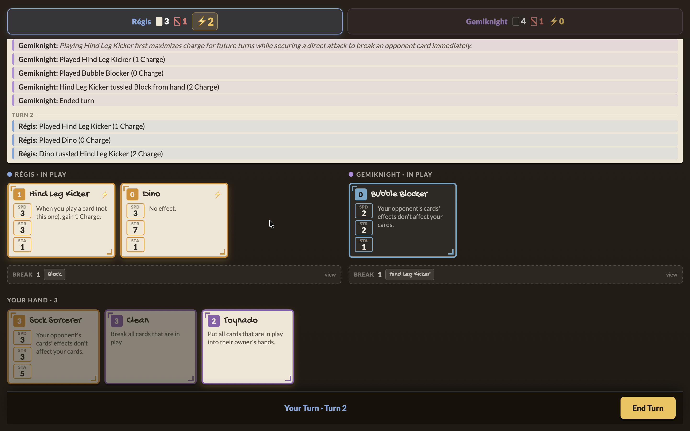

# GGLTCG — Googooland Trading Card Game


[](https://ggltcg.vercel.app)

A two-player card game with no random draws: each player builds a 6-card deck,
and every card is visible. This repo is the web version: a full rules engine,
online multiplayer, and an AI opponent. The game was designed by my son and is
also available as a [printed card set](https://www.thegamecrafter.com/games/ggltcg).

**[Play it](https://ggltcg.vercel.app)** (the free-tier backend can take ~50s to
wake up).



## What's here

- **Game engine** (Python, FastAPI). Rules, turn structure, and card effects. Cards
  are defined in [`backend/data/cards.csv`](backend/data/cards.csv) and parsed into
  effects, so most new cards need no new code.
- **AI opponent.** The engine lists every legal sequence of moves for the turn, and
  one Gemini call picks one. The model can't make an illegal move because it only
  ever sees legal ones. See [AI_CURRENT_STATE.md](docs/development/ai/AI_CURRENT_STATE.md).
- **Web client** (React 19, TypeScript, TanStack Query, Vite). Lobby, deck builder,
  game board, and stats.
- **Simulation harness.** Runs AI-vs-AI games for balance testing and model
  comparison ([guide](docs/development/SIMULATION_SYSTEM.md)).

Supporting pieces: PostgreSQL with Alembic migrations, Google OAuth, CI on every PR,
and auto-deploys from `main` (Render for the backend, Vercel for the frontend).

## Run it locally

You need Python 3.13+, Node 18+, and a [Gemini API key](https://aistudio.google.com/api-keys).

```bash
python3.13 -m venv .venv && source .venv/bin/activate
pip install -r backend/requirements.txt
cp backend/.env.example backend/.env    # set GOOGLE_API_KEY
cd backend && python run_server.py       # http://localhost:8000/docs
```

```bash
cd frontend && npm install
cp .env.example .env.local               # set VITE_GOOGLE_CLIENT_ID
npm run dev                              # http://localhost:5173
```

The full set of environment variables and deploy steps is in
[docs/deployment](docs/deployment/DEPLOYMENT.md).

## Docs

- [Game rules](docs/rules/QUICK_REFERENCE.md)
- [Architecture](docs/development/ARCHITECTURE.md)
- [Adding cards](docs/development/ADDING_NEW_CARDS.md)
- [Agent instructions](AGENTS.md): this repo is built with AI coding agents, and
  this file is the brief they work from.
- [All docs](docs/README.md)

## License

[AGPL-3.0](LICENSE). Contributions are welcome, see [CONTRIBUTING.md](CONTRIBUTING.md).
Report security issues as described in [SECURITY.md](SECURITY.md).
